# mwaibanda.com

Personal portfolio and blog built as a Go and React modular monolith.

**Live site:** [mwaibanda.com](https://mwaibanda.com)

The Go service provides the content API and serves the production frontend.
React pages are pre-rendered at build time for fast first paint and search
indexing. Content is supplied from a separate source and captured as a
validated snapshot during release builds.

> Portfolio home page
>
> 

> Blog page
>
> 

## Architecture

The application is a single deployable service with explicit domain,
application, and infrastructure boundaries. The Go API and React site are
built together and served from one container.

### Backend

```text
main.go                              Signal handling and process entry point
└── backend/
    ├── domain/                      Content entities and repository contracts
    ├── application/
    │   ├── application.go           Composition root and server lifecycle
    │   ├── config/                  Environment configuration
    │   └── service/                 Article and project use cases
    └── infrastructure/
        ├── http/                    Echo routes, handlers, middleware, pages
        └── persistence/
            ├── db/                  Embedded libSQL replica and migrations
            └── repository/          SQL adapters implementing domain contracts
```

### Frontend

```text
frontend/src/
├── domain/                          Article and work entities/contracts
├── application/                     Feature services and use cases
├── infrastructure/                  HTTP repositories, validation, query cache
├── interfaces/                      React routes, pages, providers, components
├── main.tsx                         Browser composition root
└── prerender.tsx                    Server-rendered page and metadata functions
```

### Architecture at a glance

Solid arrows show runtime/data flow. Dashed arrows show build or deployment
flow.

```mermaid
flowchart LR
    browser["Browser"]

    subgraph app["mwaibanda.com"]
        echo["Echo HTTP server"]
        pages["Pre-rendered React pages"]
        handlers["HTTP handlers"]
        services["Application services"]
        domain["Domain entities and repository contracts"]
        repositories["SQL repositories"]
        replica[("Embedded libSQL replica")]
    end

    turso[("Turso database")]
    privateContent["Private content source"]
    snapshot["Validated content snapshot"]
    build["CI frontend and container build"]
    image["Signed ARM64 image"]
    registry["GitHub Container Registry"]
    homeServer["Home server"]

    browser --> echo
    echo --> pages
    echo --> handlers --> services --> domain
    repositories -. "implements contracts" .-> domain
    services --> repositories
    repositories --> replica --> turso

    privateContent -. "restricted SSH fetch" .-> snapshot
    snapshot -.-> build
    build -.-> image --> registry
    registry -. "signature verified before pull" .-> homeServer
    homeServer --> echo
```



### Architecture style and runtime boundaries

- **Composition roots** (`main.go` and `frontend/src/main.tsx`) wire concrete
  adapters to application contracts.
- **Dependency direction** keeps use cases independent of Echo and SQL
  repository implementations.
- **Runtime validation** checks API payloads in the frontend before they enter
  application state.
- **Static rendering** generates the home page, article pages, metadata,
  `robots.txt`, and `sitemap.xml` from the release content snapshot.
- **One deployable** keeps the site and API same-origin; Echo serves both the
  generated site and `/api/v1` endpoints.
- **Turso/libSQL** provides remote persistence through an embedded replica.
  Database migrations run during application startup.

## Development

Requirements: Go 1.26+, Node.js 24, and pnpm 12.4.2.

Create local configuration and point it at a **development Turso database**.
The application applies migrations on startup; do not use production
credentials for local development.

```bash
cp .env.example .env
# Set TURSO_DATABASE_URL and TURSO_AUTH_TOKEN for a development database.
```

Start the backend from the repository root:

```bash
ENV=DEV go run .
```

In another terminal, start the React development server. Vite proxies `/api`
requests to the Go service on port 8080:

```bash
cd frontend
pnpm install --frozen-lockfile
pnpm dev
```

Open [http://localhost:5173](http://localhost:5173). The backend defaults to
port `8080`; set `PORT` to choose another port.

## Build And Checks

Run the backend checks from the repository root:

```bash
go test ./...
go vet ./...
node --test scripts/deploy.test.mjs
```

Run frontend checks and generate a local prerendered build using the committed
test content:

```bash
cd frontend
pnpm install --frozen-lockfile
pnpm lint
CONTENT_SNAPSHOT_PATH=scripts/test-content.json pnpm release
```

`pnpm release` type-checks and bundles the frontend, then pre-renders the home
page and articles. For a content-backed release build, set
`CONTENT_API_URL` to the intended API or provide `CONTENT_SNAPSHOT_PATH`.

The Docker build runs `go vet ./...`, `go test ./...`, and `go build`. It also
builds the frontend and copies the generated site into the runtime image.

## Release And Deployment

Production and staging are built for a home server's ARM64 platform and use
separate environment configuration and Turso databases.

On branch pushes, the release workflow:

1. Fetches private content over restricted SSH and stores it as a build
   artifact. Pull requests use test content instead.
2. Builds and validates the frontend and container; scans the image for
   high-severity vulnerabilities.
3. Signs the immutable image digest with Cosign and publishes it to GitHub
   Container Registry.
4. Deploys the digest over Tailscale using a restricted SSH command. The home
   server verifies the signature before pulling it, checks API responses and
   the expected release SHA, and rolls back if deployment fails.

Deployment is gated separately for staging and production. Enable the
corresponding GitHub environment setting only after its server configuration,
database, and secrets are ready. See [`.env.example`](./.env.example) for the
local configuration shape; never commit credentials.
